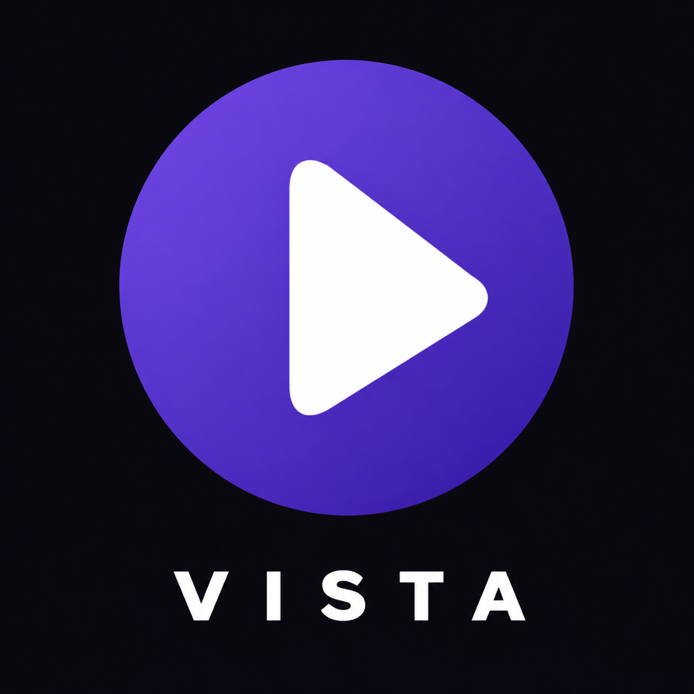

  

<h1 align="center">Stremio Vista</h1>

A native TV app for Stremio addons, written in C.

<em>Stremio™ is a trademark of its owner. Stremio Vista is independent and unofficial, and is not affiliated with, endorsed by or sponsored by Stremio. The name only describes compatibility.</em>

You bring your own Stremio account and your own addons. The app ships empty, hosts and indexes nothing, and plays only the stream links your addons return.

Stremio Vista is a custom fork of [Stremio Origin](https://github.com/stremio-origin/webos).
This repository contains Vista's development and releases.

## Features
- Home with Continue Watching first, followed by all browsable catalogs from your enabled Stremio addons in account order, plus Library and Search
- Browsing metadata on one row: duration in minutes, year, genres and IMDb rating
- A setting to disable navigation click sounds
- The best stream for your TV and connection, picked in one press
- Buttons and highlights take their colour from each title's logo or artwork
- People, reviews and a spotlight of what's new on every title
- A player with episodes, sources, subtitles and audio, skip intro and recap, and a next-episode card
- Styled subtitles as the film made them, and subtitle sync
- DTS sound converted on the TV, and Dolby Vision on TVs that support it
- Torrent playback with a buffer sized to your TV, and an optional USB drive
- Cast to the TV from your phone (the Android app is almost done)
- Library, watched state and Continue Watching synced with your Stremio account
- 11 languages, including Arabic (right to left)
- Updates from inside the app

## Install
For LG TVs running webOS 3 and later (ARM). The original app was tested on webOS 4.4;
Vista installation is verified on webOS 11.2.0 (2026), with playback validation pending.
See [compatibility](docs/compatibility.md).

Build an `.ipk` using the [local development instructions](docs/development.md),
then install it using webOS Dev Manager or the webOS CLI with Developer Mode enabled.
Published Vista packages will appear in [Releases](https://github.com/Beterer/stremio-vista/releases).
A Vista Homebrew Channel feed has not been published yet. In-app update checks
use Vista's releases, independently of the original project's updates.

## Privacy
- Sign-in goes directly to Stremio. Your account stays on the TV.
- No analytics. Nothing is sent to the developer.
- Logs stay on the TV. Sharing them is your choice: the app seals them and shows a short code.

## Development
See [local development](docs/development.md) for the Windows/Docker toolchain,
build and test commands, VS Code setup, and TV deployment prerequisites.
Use `.\tools\dev.ps1 preview -Demo` to explore the native UI in a Windows browser
with public catalogs; desktop preview playback is simulated.

## Support
- [Vista issues](https://github.com/Beterer/stremio-vista/issues)
- [Support the original developer](https://ko-fi.com/simussu)

## Credits
- Original application: [Stremio Origin](https://github.com/stremio-origin/webos).
- Interface sounds: [Interface Sounds](https://kenney.nl/assets/interface-sounds) by Kenney (CC0).
- The glass look: [liquid-glass-react](https://github.com/rdev/liquid-glass-react) by rdev; the app ships a modified version.
- Torrents: [Nuvio Engine](https://github.com/NuvioMedia/nuvio-engine) (GPL-3.0); the app ships a modified version.

## Licence
GPL-3.0, see [LICENSE](LICENSE). Third-party components and their licences: [third_party/licenses/README.txt](third_party/licenses/README.txt).
