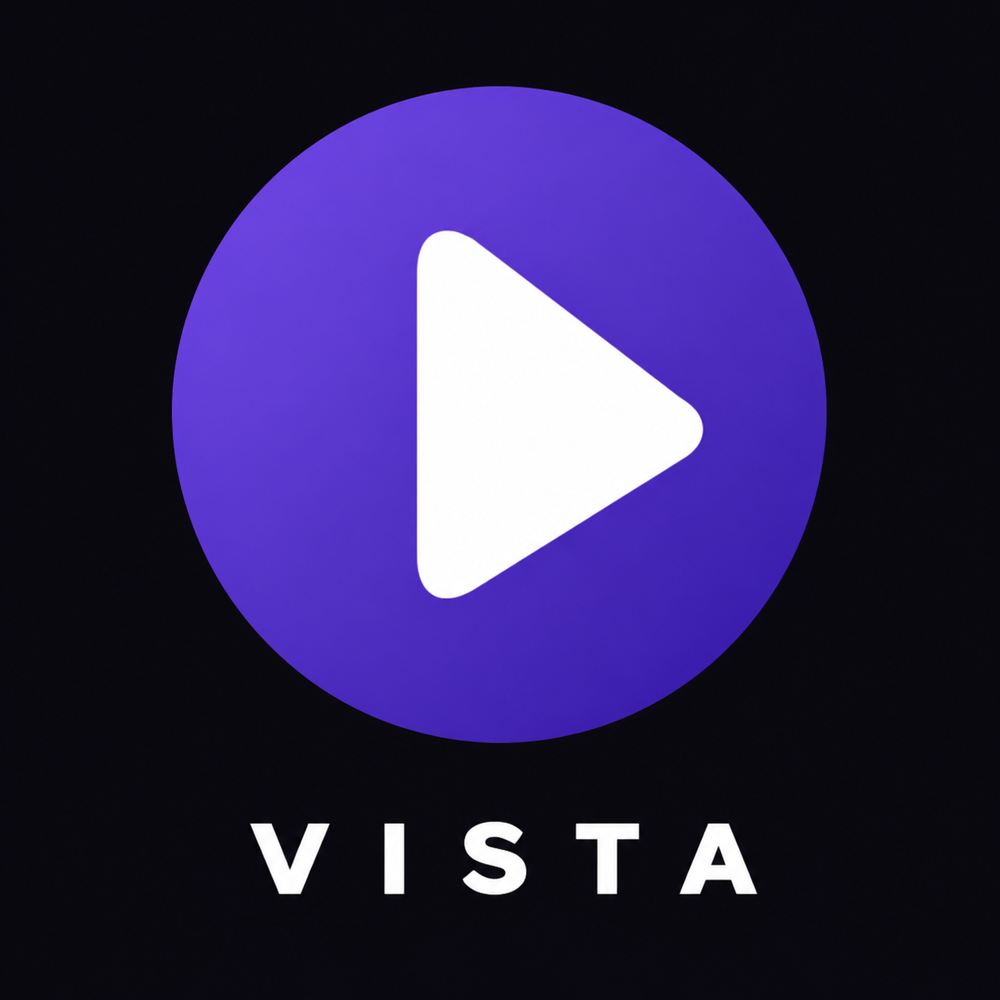

  

<h1 align="center">Stremio Vista</h1>

A native app for Stremio addons, written in C.

<em>Stremio™ is a trademark of its owner. Stremio Vista is independent and unofficial, and is not affiliated with, endorsed by or sponsored by Stremio. The name only describes compatibility.</em>

You bring your own Stremio account and your own addons. The app ships empty and plays only the stream links your addons return.

Stremio Vista is a custom fork of [Stremio Origin](https://github.com/stremio-origin/webos).
This repository contains Vista's development and releases.

## Features
- Home with Continue Watching first, followed by browsable catalogs from your enabled Stremio addons in account order, plus Library and Search
- Browsing metadata in one row with duration in minutes, year, genres and IMDb rating
- Seek previews: a picture of the film on the seek bar, for debrid and direct links
- Trakt: link with a code, scrobbling, rows on Home, watched marks and Continue Watching from Trakt
- Film collections in order, in the Library too, and the next film after the credits
- Live TV and sports from your addons, with All channels, Favorites, Recent and a preview as you browse
- The best stream picked in one press, and a sources tray with a tab for each addon
- Styled subtitles as the film made them, with fonts (Arabic too), size, colour, position, brightness and sync
- Forced-only subtitles and per-show subtitle and audio preferences
- Chapters, skip intro and recap, and a next-episode card in two sizes
- Auto-play next episode, and a trailer behind Home
- Spoilers blurred for episodes you haven't watched, and upcoming episodes on Home
- A viewer notice as a film starts: an age and its reasons, from IMDb's Parents Guide
- A row for every catalog, with artwork, logos, trailers, people, reviews and ratings
- Titles and descriptions in your language
- Library, watched state and Continue Watching synced with your Stremio account
- Accent colour, a 12 or 24 hour clock and interface sounds
- Dolby Vision on TVs that support it
- DTS sound converted on the TV
- Torrents, with an optional USB drive
- Picture size: original, fill or zoom
- The app's own screen saver
- The pointer hides when idle, and OK presses what you point at
- 28 languages, Arabic included (right to left); updates and Share logs from the app

## Install
For LG TVs running webOS 3 and later (ARM). The original app was tested on webOS 4.4;
Vista installation is verified on webOS 11.2.0 (2026), with playback validation pending.
See [compatibility](docs/compatibility.md).

Build an `.ipk` using the [local development instructions](docs/development.md),
then install it using webOS Dev Manager or the webOS CLI with Developer Mode enabled.
Published Vista packages will appear in [Releases](https://github.com/Beterer/stremio-vista/releases).
A Vista Homebrew Channel feed has not been published yet. In-app update checks
use Vista's releases, independently of the original project's updates.

## Privacy
- Sign-in goes directly to Stremio. Your account stays on the TV.
- No analytics. Nothing is sent to the developer.
- Logs stay on the TV. Sharing them is your choice: Settings > About > Share logs.

## Trakt
Trakt is optional. You link it with a code and the sign-in stays on the TV. While it is linked, what you watch is added to your Trakt history. The app also reads your Trakt name and stats, history, watchlist, recommendations, watched marks and paused positions, only to show them in the app. Unlink any time: Settings > Trakt > Disconnect Trakt.

Stremio Vista uses Trakt but is not endorsed or certified by Trakt.

## Development
See [local development](docs/development.md) for the Windows/Docker toolchain,
build and test commands, VS Code setup, and TV deployment prerequisites.
Use `.\tools\dev.ps1 preview -Demo` to explore the native UI in a Windows browser
with public catalogs; desktop preview playback is simulated.

## Support
- [Vista issues](https://github.com/Beterer/stremio-vista/issues)
- [Support the original developer](https://ko-fi.com/simussu)
-  [Discord](https://discord.gg/SJEtyV3kW6)

## Credits
- Original application: [Stremio Origin](https://github.com/stremio-origin/webos).
- Interface sounds: [Interface Sounds](https://kenney.nl/assets/interface-sounds) by Kenney (CC0).
- The glass look: [liquid-glass-react](https://github.com/rdev/liquid-glass-react) by rdev; the app ships a modified version.
- Torrents: [Nuvio Engine](https://github.com/NuvioMedia/nuvio-engine) (GPL-3.0); the app ships a modified version.

## Licence
GPL-3.0, see [LICENSE](LICENSE). Third-party components and their licences: [third_party/licenses/README.txt](third_party/licenses/README.txt).

Provided as is, for personal use on devices you own.
